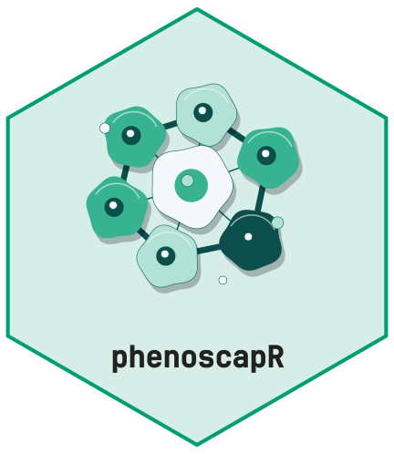

<!-- cttir-vignette-logo: start -->
<style>
.cttir-vignette-logo { float: right; width: 120px; max-width: 30%; margin: 0 0 1rem 1.5rem; }
.cttir-vignette-logo img { width: 100%; height: auto; border: 0; background: transparent; box-shadow: none; }
.cttir-vignette-logo .cttir-vignette-logo-light { display: block; }
.cttir-vignette-logo .cttir-vignette-logo-dark { display: none; }
@media (prefers-color-scheme: dark) {
  .cttir-vignette-logo .cttir-vignette-logo-light { display: none; }
  .cttir-vignette-logo .cttir-vignette-logo-dark { display: block; }
}
[data-bs-theme="light"] .cttir-vignette-logo .cttir-vignette-logo-light { display: block; }
[data-bs-theme="light"] .cttir-vignette-logo .cttir-vignette-logo-dark { display: none; }
[data-bs-theme="dark"] .cttir-vignette-logo .cttir-vignette-logo-light { display: none; }
[data-bs-theme="dark"] .cttir-vignette-logo .cttir-vignette-logo-dark { display: block; }
</style>
<div class="cttir-vignette-logo">
  
  
</div>
<!-- cttir-vignette-logo: end -->

<!-- badges: start -->
[](https://github.com/CTTIR/phenoscapR/actions/workflows/R-CMD-check.yaml)
[](https://cttir.github.io/phenoscapR/)
[](https://app.codecov.io/gh/CTTIR/phenoscapR?branch=main)
[](https://opensource.org/licenses/MIT)
[](https://lifecycle.r-lib.org/articles/stages.html#experimental)
<!-- badges: end -->

```{r setup, include = FALSE}
knitr::opts_chunk$set(
  collapse = TRUE,
  comment = "#>",
  fig.width = 7,
  fig.height = 4.5,
  dpi = 96
)
has_uwot <- requireNamespace("uwot", quietly = TRUE)
has_deldir <- requireNamespace("deldir", quietly = TRUE)
```


## Overview

Every phenoscapR plotting function returns a **ggplot** object, so you can add
themes, facets, or annotations as usual, and they all draw from the global
palette system for consistent colours across a figure panel. This gallery
shows each one on the bundled example data.

```{r prep}
library(phenoscapR)
library(ggplot2)
data(phenoscapR_example)

obj <- phenoscapR_example
obj@meta_data$phenotype <- obj@meta_data$phenotype_true
obj <- NormaliseData(obj, method = "zscore")

# A single tissue for the spatial maps.
a <- obj[obj$sample_id == "tonsil_A", ]
# Cell subsetting invalidates cached local density; compute it on this tissue.
a <- CellDensity(a, radius = 40)
markers <- c("CD20", "CD3", "CD8", "PanCK")
```

## Tissue maps

### `CellMap()` — phenotype map

```{r cellmap}
CellMap(a)
```

### `FeaturePlot()` — marker intensity in space

```{r featureplot, fig.height = 5}
FeaturePlot(a, features = markers)
```

### `DensityPlot()` — local cell density

```{r densityplot}
DensityPlot(a)
```

### `SpatialNetworkPlot()` — cell-contact graph

```{r network, eval = has_deldir}
a_net <- DelaunayNetwork(a, max_edge = 60)
SpatialNetworkPlot(a_net)
```

## Marker distributions

### `ViolinPlot()` and `BoxPlot()`

```{r violin}
ViolinPlot(a, features = markers, group_by = "phenotype")
```

```{r box}
BoxPlot(a, features = markers, group_by = "phenotype")
```

### `RidgePlot()` and `HistogramPlot()`

```{r ridge}
RidgePlot(a, features = markers, group_by = "phenotype")
```

```{r histogram, fig.height = 4}
HistogramPlot(a, feature = "CD20", group_by = "phenotype")
```

### `DotPlot()` — mean expression × fraction expressing

```{r dotplot, fig.height = 4}
DotPlot(a, features = c("CD3", "CD4", "CD8", "CD20", "CD68", "PanCK", "FoxP3"))
```

## Summaries

### `MarkerHeatmap()` — phenotype signatures

```{r heatmap, fig.height = 5}
MarkerHeatmap(obj)
```

### `CompositionPlot()` — phenotype proportions

```{r composition, fig.height = 4}
CompositionPlot(obj, group_by = "sample_id")
```

### `InteractionPlot()` — co-localisation scores

```{r interactions}
InteractionPlot(InteractionMatrix(obj, radius = 40))
```

### `QCPlot()` — any metadata pair

```{r qcplot, fig.height = 4}
QCPlot(a, x = "cell_area", y = "density", colour_by = "phenotype")
```

## Dimensionality reductions

Reduce marker space and plot it with `DimPlot()` / `EmbeddingPlot()`.

```{r pca}
obj <- RunPCA(obj, n_pcs = 10)
DimPlot(obj, reduction = "pca", colour_by = "phenotype")
```

```{r umap, eval = has_uwot}
# Base SVD is sufficient for this small marker panel and avoids dependence
# on an optional truncated-SVD solver when disconnected groups need PCA init.
obj <- RunUMAP(obj, dims = 10, n_neighbors = 15, seed = 1,
               pca_method = "svd", n_threads = 1)
EmbeddingPlot(obj, reduction = "umap", colour_by = "phenotype")
```

## Theming and palettes

Because each plot is a plain ggplot, standard customisation just works:

```{r theme}
CellMap(a) +
  labs(title = "Tonsil A — phenotype map") +
  theme(plot.title = element_text(face = "bold"))
```

The package palette is global. Set it once and every plot follows. Any
viridis-family option works (`"viridis"`, `"inferno"`, `"plasma"`,
`"cividis"`, `"rocket"`, `"mako"`):

```{r palette}
SetPalette("rocket")
CompositionPlot(obj, group_by = "sample_id")
```

```{r reset-palette, include = FALSE}
SetPalette("viridis")
```

`PaletteDiscrete()`, `PaletteContinuous()`, and `CustomGradient()` expose the
same colours for use in bespoke plots.

```{r palette-fns}
PaletteDiscrete(5)
```

## See also

- **[Getting Started](phenoscapR.html)** — the end-to-end workflow
- **[Advanced Spatial Analysis](phenoscapR-03-spatial-analysis.html)** — the statistics behind these plots
